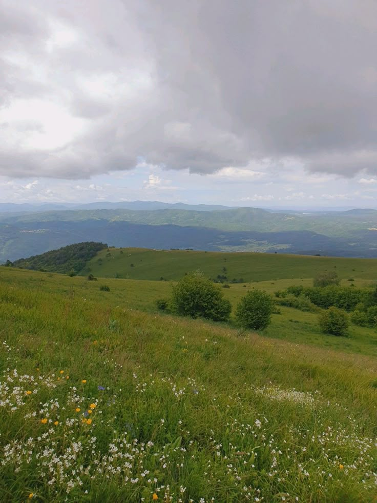

“Hey, the winds are blowing in a strange direction, and the birds have become silent. I think they’re approaching.”

“That’s strange… why does the sensor not detect anything then?”

“Please, try and pay attention to the energy… something is incoming. We should contact XA0, and have him prepare for when we arrive, and also to send extra Tools to us.”

“... Are you sure?” As a droplet hits my mouth. A few more hit my face, until I can’t distinguish between them.

“We should just head 3km North, we can find a Temper to stay in. C’mon”

I turn away from him, looking into the distance where only valleys and plains exist, and also in a different direction than our destination.
Shit. We should at least start running and hope for the best.

On that bitter spring day, the sun left us to drown, making my memories hazed. But I can remember the laughter as we ran, freezing water pelting our faces, washing them clean of worry. 

And I held his cold, wet hand, as he led me along the path--promising to make it through together, and forever.

The Temper was old, dust as if it hadn’t been used in long, humid. But we huddled and held each other for warmth, hearts beating in tandem, pulsing through our wet shirts. 

Our skin, my face in the crook of his neck, glided easily, a sickly smooth feeling. I felt drops of water on my head once more-- a leak, his hair?

Looking up in the indoor room, I finally can see his tears.

